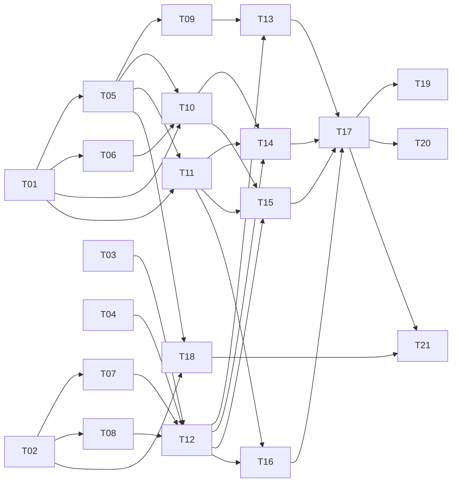

# Backlog da POC do chatbot — execução por agentes em waves

> Derivado de `plan.md` (2026-11-18). Cada ticket é autocontido para ser
> entregue a **um agente**. As waves têm de 1 a 4 agentes em paralelo. Uma
> wave só começa quando todas as anteriores de que depende estão mescladas
> em `main`.

## 1. Como usar

1. Rode uma wave por vez. Cada agente recebe: este arquivo, o ID do ticket e a
   instrução "execute somente o ticket X".
2. Cada agente trabalha no **próprio git worktree/branch**
   (`poc/<ID>-<slug>`). Ao fim da wave, mescle as branches em `main` e rode
   `npm run check && npm test` no resultado.
3. Nos **pontos de controle** (G1, G2, G3) a sessão principal aplica as
   migrations pelo MCP do Neon (em modo escrita desde 2026-11-18), **sempre
   com a confirmação do usuário antes de cada uma**. Deploy e ensaio
   continuam com o usuário.

### Modelos

| Modelo | ID | Quando foi escolhido |
|---|---|---|
| **Opus 5.5** | `claude-opus-5-5` (Agent: `opus`) | Concorrência e transações, máquina de estados, integração no caminho crítico, contratos externos incertos |
| **Sonnet 5.5** | `claude-sonnet-5-5` (Agent: `sonnet`) | Implementação padrão com regras claras: repositórios, migrations, fluxos |
| **Haiku 5.5** | `claude-haiku-5-5` (Agent: `haiku`) | Funções puras com testes, conteúdo, documentação |

### Mapa de waves

```
W1  T01 Sonnet │ T02 Sonnet │ T03 Haiku  │ T04 Haiku
W2  T05 Sonnet │ T06 Sonnet │ T07 Haiku  │ T08 Sonnet
    ── G1: aplico 010–012 (com seu OK) e estendo a grade ──
W3  T09 Sonnet │ T10 Opus   │ T11 Sonnet │ T12 Opus
W4  T13 Sonnet │ T14 Opus   │ T15 Sonnet │ T16 Sonnet
W5  T17 Opus   │ T18 Sonnet
    ── G2: aplico 013–014 (com seu OK); você faz deploy ──
W6  T19 Opus (opcional) │ T20 Haiku │ T21 Sonnet
    ── G3: ensaio da apresentação ──
```

Caminho crítico: **T02 → T08 → T12 → T14 → T17 → T21**.



## 2. Regras comuns a todos os agentes

- Leia `CLAUDE.md` (seção "POC decisions"), `plan.md` e a seção 3 deste
  arquivo antes de codar.
- **Neon:** agentes de ticket usam o MCP `neon` só para leitura.
  - `project_id` = `orange-snow-21167535`; branch padrão `production`.
  - Use o MCP para conferir colunas e validar `SELECT`/`EXPLAIN`.
  - **Nunca** rode escrita, DDL ou DML pelo MCP, mesmo que ele esteja em modo
    escrita: escrita só via arquivo de migration, aplicado pela sessão
    principal nos pontos de controle, com confirmação do usuário.
  - Não selecione `body` de mensagens, nomes ou telefones: só estrutura e agregados.
- **Escopo de arquivos:** só crie ou edite os arquivos listados no ticket.
  Precisa de mais? Pare e reporte; não edite arquivos de outro ticket da
  mesma wave.
- **Ninguém edita o script `check` do `package.json`** depois de T03 (ele
  passa a encontrar os arquivos sozinho).
- **Ninguém edita `CLAUDE.md`, `docs/IMPLEMENTATION_STATUS.md` ou `plan.md`**,
  exceto T20.
- **Migrations:**
  - número fixo por ticket (tabela abaixo); nunca renumerar;
  - só acrescentar, nunca renomear coluna ou tabela (contrato com o Power BI);
  - todo comando sobre `clinica_simulada` vai dentro de uma guarda
    `do $$ begin if to_regnamespace('clinica_simulada') is not null then … end if; end $$;`,
    para não quebrar banco novo (preview), que não tem esse schema;
  - cada migration nova ganha teste de regex em `test/*Schema.test.js`, no
    padrão de `test/databaseSchema.test.js`.
- **Testes:** `node:test` com pool falso (padrão `test/database.test.js`).
  Termine com `npm run check && npm test` verdes.
- Fuso: `America/Bahia`. Textos do bot em português, dentro dos limites do
  WhatsApp:
  - lista: até 10 linhas; título da linha ≤ 24 caracteres, descrição ≤ 72;
  - botões: até 3 por mensagem, título ≤ 20 caracteres.
- Não use IA generativa para responder ao paciente.

| Migration | Ticket |
|---|---|
| `010_bot_runtime.sql` | T02 |
| `011_clinic_poc_prep.sql` | T05 |
| `012_clinic_schedule_extension.sql` | T06 |
| `013_clinic_faq_content.sql` | T09 |
| `014_bot_reporting.sql` | T18 |

## 3. Contratos compartilhados

São fixados aqui para que tickets da mesma wave possam programar contra
mocks. Mudar um contrato exige atualizar este arquivo e avisar os tickets
dependentes. Todas as funções são `async` e recebem e devolvem `camelCase`.

### 3.1 Tabelas do bot (T02, schema `public`)

- `bot_config(key text pk, value jsonb not null, description text, updated_at timestamptz default now())`
- `conversation_state(wa_id text pk references contacts, flow text not null, step text not null, context jsonb not null default '{}', cpf_attempts smallint default 0, misunderstood_count smallint default 0, expires_at timestamptz not null, updated_at timestamptz default now())`
- `handoffs(id uuid pk, wa_id text not null, reason text not null check (reason in ('patient_request','payment','clinical_or_urgency','late_change','bot_failure','identity_failure','document_request')), in_business_hours boolean not null, requested_at timestamptz default now(), first_team_reply_at timestamptz, closed_at timestamptz)`, com índice único parcial "um aberto por `wa_id`" (`where closed_at is null`).

### 3.2 Módulos

| Módulo (dono) | Exporta |
|---|---|
| `src/services/bot/cpf.js` (T03) | `normalizeCpf(text)→string\|null`, `isValidCpf(digits)→bool`, `maskCpf(digits)→'***.***.***-09'`, `findCpfInText(text)→{digits,start,end}\|null` |
| `src/services/bot/businessHours.js` (T03) | `isWithinSupportHours(date, {start,end,days}, timezone)→bool`, `nextSupportOpening(date, cfg, tz)→Date` |
| `src/services/bot/intents.js` (T04) | `detectIntent(text)→'human'\|'payment'\|'urgency'\|'clinical'\|'reschedule'\|'cancel'\|'book'\|'my_appointments'\|'prices'\|'insurance'\|'address'\|'hours'\|'menu'\|'document'\|null` |
| `src/config/botConfig.js` (T07) | `createBotConfig({pool, ttlMs})→{ get() }`. `get()` devolve `{timezone, rescheduleMinNoticeHours, cancelMinNoticeHours, humanSupportHours:{start,end,days}, messageRetentionDays, bookingHorizonDays, conversationStepTimeoutMinutes, handoffSilenceHours, cpfMaxAttempts, maxMisunderstoodReplies, reminderHoursBefore}` com defaults quando falta a linha |
| `src/services/bot/stateStore.js` (T08) | `getActive(waId, now)→state\|null` (ignora expirado), `save(state)`, `clear(waId)` |
| `src/services/bot/handoffRepository.js` (T08) | `open({waId, reason, inBusinessHours})`, `getOpen(waId)`, `markFirstTeamReply(waId, at)`, `closeOpen(waId, at)` |
| `src/services/clinic/catalogRepository.js` (T09) | `listServices()→[{id,name,durationMin,slotCapacity,professionals:[{id,name}]}]`, `listInsurancePlans()→[{id,name}]`, `listPrices()→[{serviceId,kind:'avulso'\|'pacote'\|'mensalidade',amount}]`, `listHolidays({from,to})→[date]`, `listFaqEntries()→[{slug,question,answer}]`, `getOpeningHours()→[{weekday,firstHour,lastHour}]` |
| `src/services/clinic/appointmentRepository.js` (T10) | `ensureScheduleHorizon(days)`, `listAvailableDays({serviceId, professionalId?, from, horizonDays})→[{date,freeSlots}]`, `listAvailableTimes({serviceId, professionalId?, date})→[{hour,professionalId,professionalName,remaining}]`, `book({...})→{ok,appointment}\|{ok:false,reason}`, `listUpcoming({patientId, now})`, `reschedule({...})`, `cancel({...})`. `reason` ∈ `slot_unavailable`, `too_late`, `not_found` |
| `src/services/clinic/patientRepository.js` (T11) | `findPatientByCpf(cpf)→{id,firstName}\|null`, `findPatientByWaId(waId)`, `createPatient({name,cpf,origin,channel})→{id}`, `linkContact({waId,patientId,leadId})`, `upsertLead({waId,stage,channel,serviceInterestId,outsideBusinessHours,transferred,booked,patientId})→{leadId}` |
| `src/services/bot/engine.js` (T12) | `createBotEngine({flows, stateStore, handoffs, config, clock, sendReply, logger})→{ handle(inbound) }` |

### 3.3 Contrato de fluxo (T12 define, T13–T16 implementam)

```js
// Cada fluxo: { name, start(ctx, input?), handle(ctx, input) } → Promise<FlowResult>
// ctx   = { waId, now, config, state, patient /* {id,firstName}|null, verificado na conversa */, repos }
// input = { kind: 'text'|'list_reply'|'button_reply', text, replyId, intent }
// FlowResult = {
//   replies: [ { type:'text', text } | { type:'list', body, buttonTitle, sections } | { type:'buttons', body, buttons } ],
//   next:    { flow, step, context } | null,   // null = encerra a etapa (volta ao estado livre)
//   handoff: { reason } | undefined,
//   events:  [ { stepKey } ],                   // ex.: 'booking:choose_day'
//   misunderstood: boolean | undefined          // a entrada não foi entendida
// }
```

- IDs de linhas e botões: `<flow>:<step>|<valor>`, por exemplo
  `booking:day|2026-11-24`. O engine roteia por esse prefixo mesmo sem estado
  salvo.
- Fluxos registrados: `menu`, `faq`, `booking`, `my_appointments`, `triage`.

#### 3.3.1 Refinamentos do T12 (2026-11-18) — valem para T13–T17

O contrato completo está no cabeçalho de `src/services/bot/engine.js`. Resumo:

- `inbound = {waId, receivedAt, kind, text, replyId}`; `inboundFromNormalizedMessage(message)` monta a partir do normalizador.
- `ctx = {waId, now, config, state, patient, inBusinessHours, repos}`. `state` só é o do fluxo chamado; `patient` vem de `state.context.patient` e o fluxo o grava ali depois de validar o CPF. O engine carrega o paciente entre fluxos; ele se perde quando o estado é limpo ou expira.
- `input = {kind, text, replyId, intent, reply}`; `reply = {flow, step, value}` quando o id segue `<flow>:<step>|<value>`. Só texto recebe `intent`.
- `next.cpfAttempts` (opcional) é gravado em `cpf_attempts`.
- **Troca de fluxo:** se `next.flow` difere do fluxo que respondeu, o engine chama `flows[next.flow].start(ctx)` sem `input`, com `ctx.state` montado do `next`, e concatena as respostas (máx. 3 trocas). `booking.start` deve olhar `ctx.state.step` (a triagem devolve para `booking:choose_day`).
- **`handoff`:** o engine abre, limpa o estado, ignora `next` e acrescenta o texto padrão da equipe (com próxima abertura fora do horário). O fluxo só explica o motivo.
- **Listas > 10 linhas:** o fluxo emite a lista inteira; o engine pagina (`context._pages`, reservado) e responde "Ver mais" sozinho.
- Saída de `handle`: `{replies, events, handoff, flow, silenced}`; `flow` serve ao T17 para `current_intent`.

#### 3.3.2 Achados da W3 que os fluxos precisam respeitar

- **Formas de pagamento sem preço** (T10): Pilates por convênio ou avulso e Massagem em pacote ou mensalidade gravam `valor_sessao` nulo. O fluxo de agendamento só oferece as combinações com preço em `d_precos`/`d_convenios` (Pilates: mensalidade; Massagem: avulso).
- **Dupla reserva** (T10): o repositório não impede o mesmo paciente de reservar o mesmo horário duas vezes; o fluxo confere `listUpcoming` antes de confirmar.
- **Remarcar para o mesmo horário** (T10) conta a consulta original como ocupada; o fluxo não oferece o horário atual.
- **`jornada_contatos.origem`** (T11): o CHECK só aceita `lead_planilha` e `paciente_sem_lead`; não existe `'chatbot'`.
- **SQL de escrita do T10/T11 validado** em 2026-11-18 num branch temporário do Neon (já apagado): lead, contato, paciente novo, CPF duplicado, reservas, corrida na última vaga (6 ok + 1 `slot_unavailable`), remarcação, cancelamento, `not_found`, `too_late` e auditoria. Reserva no mesmo dia é permitida (o plano só exige 24 h para remarcar e cancelar).
- **Pacientes de demonstração** passam a se chamar (ver também 3.3.3 abaixo) Ana, Bruno, Carla, Diego e Elisa Teste (migration 013), para a saudação usar o primeiro nome.

#### 3.3.3 Contratos comuns da W4 (fixados em 2026-11-18)

- **`ctx.repos`** = `{ catalog, appointments, patients }`, criados por
  `createCatalogRepository`, `createAppointmentRepository` e
  `createPatientRepository` (o T17 monta). Fluxos não criam repositórios.
- **Paciente identificado:** o fluxo que valida o CPF (T15) ou cadastra (T16)
  grava `context.patient = { id, firstName }` no `next.context`. Não usar
  `patientId` solto. O CPF nunca vai para `context`, respostas ou `events`.
- **Pagamento** no `context`: `payment = { method, insuranceId }`, com
  `method` ∈ `PAYMENT_METHODS` de `appointmentRepository.js`
  (`'Convênio'`, `'Mensalidade'`, `'Pacote particular'`, `'Particular avulso'`)
  e `insuranceId` só para `'Convênio'`. Opções por serviço (3.3.2): Pilates →
  só `Mensalidade`; Massagem → só `Particular avulso`; os demais →
  `Convênio`, `Particular avulso`, `Pacote particular`.
- **Triagem → agendamento:** `next: { flow: 'booking', step: 'choose_day',
  context: { serviceId, payment, patient, newPatient: true } }`.
- **Menu (6.2 do `plan.md`)** — ids das linhas (T13 dono):
  `menu:main|booking`, `menu:main|my_appointments`, `menu:main|services`,
  `menu:main|insurance`, `menu:main|hours_address`, `menu:main|first_visit`,
  `menu:main|human`. O menu troca de fluxo devolvendo `next` com o fluxo de
  destino (o engine chama `start`). `menu:main|human` devolve
  `handoff: { reason: 'patient_request' }`.
- **Botões comuns** nas respostas do FAQ: `faq:answer|book` (Agendar),
  `menu:main|show` (Voltar ao menu), `menu:main|human` (Falar com a equipe).

### 3.4 Etapas de lead (`f_leads.etapa_final`)

Atualizada a cada passo com o valor "Abandonou na …" da etapa atual, e
sobrescrita no fim:

| Situação | Valor |
|---|---|
| Ainda no início | `Abandonou na saudação` |
| Escolhendo serviço | `Abandonou na escolha do serviço` |
| Escolhendo horário | `Abandonou na escolha do horário` |
| Marcou | `Agendou pelo chatbot` |
| Foi para a equipe | `Transferido para atendente` |

---

## 4. Tickets

### W1 — fundações (sem dependências)

#### T01 — Snapshot do schema `clinica_simulada` no repositório
- **Modelo:** Sonnet. Precisa de cuidado com constraints e FKs, sem lógica.
- **Depende de:** —
- **Arquivos:** cria `db/poc/clinica_simulada_schema.sql` e `db/poc/README.md`.
- **Escopo:** via MCP (`information_schema`, `pg_constraint`), reconstruir o
  DDL de referência de todas as tabelas de `clinica_simulada` e a definição
  das views `bi_simulado` e `bi_operacional` (`pg_get_viewdef`).
  - O arquivo é **referência, não migration**: comentar isso no topo.
  - No README, listar:
    - os domínios observados de `f_agendamentos.status`, `canal_marcacao`,
      `turno`, `forma_pagamento` e `f_leads.etapa_final`;
    - quais FKs apontam para `clinica_simulada.contacts`/`conversations` (por
      exemplo, `jornada_contatos.wa_id`, `agendamento_chatbot.conversation_id`);
    - a nulabilidade de `agendamento_chatbot.conversation_id`/`dispatch_id`.
- **Aceite:** todas as 23 tabelas e todas as views presentes; nenhuma linha de dados copiada.

#### T02 — Migration 010: tabelas do bot
- **Modelo:** Sonnet
- **Depende de:** —
- **Arquivos:** cria `db/migrations/010_bot_runtime.sql` e `test/botRuntimeSchema.test.js`.
- **Escopo:** tabelas da seção 3.1 e seed de `bot_config` (`on conflict do nothing`):

  | Chave | Valor |
  |---|---|
  | `timezone` | `"America/Bahia"` |
  | `reschedule_min_notice_hours` | 24 |
  | `cancel_min_notice_hours` | 24 |
  | `human_support_hours` | `{"start":"08:00","end":"18:00","days":[0,1,2,3,4,5,6]}` |
  | `message_retention_days` | `null` |
  | `booking_horizon_days` | 21 |
  | `conversation_step_timeout_minutes` | 30 |
  | `handoff_silence_hours` | 12 |
  | `cpf_max_attempts` | 3 |
  | `max_misunderstood_replies` | 3 |
  | `reminder_hours_before` | `[24,4]` |

  Também: `grant select` para `powerbi_reader` em `handoffs`, se o role
  existir (padrão da migration 007).
- **Aceite:** teste de regex cobrindo as tabelas, o check de `reason`, o índice parcial e as 11 chaves.

#### T03 — Utilitários puros: CPF, horário de atendimento e `check` automático
- **Modelo:** Haiku
- **Depende de:** —
- **Arquivos:** cria:
  - `src/services/bot/cpf.js`
  - `src/services/bot/businessHours.js`
  - `test/cpf.test.js`
  - `test/businessHours.test.js`
  - `scripts/check.js`

  Edita o `check` do `package.json`.
- **Escopo:**
  - funções da seção 3.2: CPF com dígitos verificadores, rejeitando
    sequências repetidas; horário considerando o fuso;
  - `scripts/check.js` percorre `src/` e `scripts/` e roda `node --check` em
    cada `.js`;
  - `"check": "node scripts/check.js"`.
- **Aceite:** testes com CPFs válidos e inválidos, máscara, CPF no meio de
  um texto, 07:59/08:00/18:00 e virada de dia no fuso.

#### T04 — Detector de intenção por palavras-chave
- **Modelo:** Haiku
- **Depende de:** —
- **Arquivos:** cria `src/services/bot/intents.js` e `test/intents.test.js`.
- **Escopo:** `detectIntent` da seção 3.2.
  - Normalizar o texto: minúsculas, sem acento, sem pontuação.
  - Prioridade: `urgency` > `human` > `payment` > `clinical` > o resto.
  - Listas de palavras no topo do arquivo:
    - urgência: "urgente", "emergência", "muita dor", "caí", "sangr…";
    - pagamento: "pagar", "boleto", "pix", "mensalidade", "cobrança",
      "fatura", "valor em aberto";
    - "preço" e "valor" isolados → `prices`, não `payment`.
  - `menu`/`inicio` → `menu`.
- **Aceite:** pelo menos 40 casos de teste, incluindo frases ambíguas
  ("quanto custa o pilates" → `prices`; "quero pagar o pilates" → `payment`).

### W2 — dados e infraestrutura do bot

#### T05 — Migration 011: preparar `clinica_simulada` para escrita
- **Modelo:** Sonnet
- **Depende de:** T01
- **Arquivos:** cria `db/migrations/011_clinic_poc_prep.sql` e `test/clinicPocPrepSchema.test.js`.
- **Escopo** (tudo dentro da guarda de schema):
  1. Sequences para `f_agendamentos.agendamento_id`, `d_pacientes.paciente_id`,
     `f_leads.lead_id` e `f_recebimentos.recebimento_id`, começando em
     `max+1` (`setval`), e uso delas como default.
  2. `d_pacientes.cpf text unique`, preenchido para todos os pacientes com
     **CPFs fictícios válidos e determinísticos**: função SQL que gera os 9
     dígitos a partir de `paciente_id` e calcula os 2 verificadores.
  3. Cinco pacientes de demonstração com nomes fictícios e CPFs fixos,
     listados no comentário do arquivo (para o roteiro do T20).
  4. Tabela `d_precos(servico_id, tipo check in ('avulso','pacote','mensalidade'), valor numeric, pk(servico_id,tipo))`
     com os valores da seção 3.2 de `plan.md`. Pilates: mensalidade com o valor máximo observado.
  5. Índices de apoio:
     - `f_agendamentos(paciente_id, data)`;
     - `f_agendamentos(servico_id, profissional_id, data, hora) where status in ('Agendado','Realizado')`;
     - `jornada_contatos(paciente_id)`.
  6. `agendamento_chatbot.dispatch_id` passa a aceitar nulo
     (`alter column dispatch_id drop not null`), porque uma reserva iniciada
     pelo paciente não tem disparo. Manter o `unique` e a FK (nulos não
     conflitam no `unique`). Não mexer em `conversation_id`: o T10 cria ou
     reaproveita a conversa aberta em `clinica_simulada.conversations`
     (há índice único parcial `wa_id where status='open'`). Achado do T01,
     decidido em 2026-11-18.
- **Aceite:**
  - o teste de regex confere a guarda, as sequences, o `unique` do CPF,
    `d_precos` e o `drop not null` de `dispatch_id`;
  - via MCP, conferir que nenhum `max(id)` mudou desde o T01 (registre os valores no PR).

#### T06 — Migration 012 e script: estender a grade de horários
- **Modelo:** Sonnet
- **Depende de:** T01
- **Arquivos:** cria `db/migrations/012_clinic_schedule_extension.sql`,
  `scripts/extend-clinic-schedule.js` e `test/clinicScheduleExtension.test.js`.
  Edita `package.json` (só o script `"extend-schedule"`).
- **Escopo:** função `clinica_simulada.extend_schedule(p_days int default 60) returns int`, idempotente:
  - preenche `d_calendario` de `max(data)+1` até `current_date + p_days`, com
    feriados nacionais fixos (01/01, 21/04, 01/05, 07/09, 12/10, 02/11,
    15/11, 20/11, 25/12) marcados como feriado e não úteis;
  - copia o padrão de `f_capacidade` da **mesma semana-do-ano anterior** (ou
    das últimas 4 semanas como fallback) para cada dia útil novo, com
    `on conflict do nothing`;
  - devolve quantas linhas inseriu.

  O script chama a função usando `DATABASE_URL`.
- **Aceite:** teste de regex. No PR, um `EXPLAIN` via MCP da query de leitura
  de padrão (sem executar a função).

#### T07 — Loader de `bot_config`
- **Modelo:** Haiku
- **Depende de:** T02
- **Arquivos:** cria `src/config/botConfig.js` e `test/botConfig.test.js`.
- **Escopo:** contrato da seção 3.2:
  - converte `snake_case` → `camelCase`;
  - cache com TTL (padrão 60 s);
  - defaults iguais ao seed do T02 quando a chave falta ou a consulta falha
    (registra aviso).
- **Aceite:** testes de cache, de default e de conversão.

#### T08 — `stateStore` e `handoffRepository`
- **Modelo:** Sonnet
- **Depende de:** T02
- **Arquivos:** cria `src/services/bot/stateStore.js`,
  `src/services/bot/handoffRepository.js` e `test/botRepositories.test.js`.
- **Escopo:** contratos da seção 3.2, com SQL parametrizado.
  - `save` faz upsert por `wa_id`.
  - `open` é idempotente (se já existe aberto, devolve o existente).
  - `markFirstTeamReply` só preenche se for nulo.
- **Aceite:** testes com pool falso no padrão `test/database.test.js`.

### G1 — ponto de controle humano

- [x] Mesclar W1 e W2 e rodar `npm run migrate` (aplica 010, 011 e 012).
      Feito em 2026-11-18, depois de testado num branch temporário do Neon.
- [x] Rodar `npm run extend-schedule` e conferir a saída (linhas inseridas > 0).
      2258 linhas; calendário até 2027-01-17. Pacientes demo: ids 2680–2684.
- [ ] Conceder à conta de banco do bot `insert`/`update`/`usage` nas tabelas
      de `clinica_simulada` usadas por T10/T11 (lista no README do T01). Na
      conta do bot atual (dona do banco) isso não é necessário.

### W3 — repositórios da clínica e motor

#### T09 — Repositório de catálogo e conteúdo do FAQ (migration 013)
- **Modelo:** Sonnet
- **Depende de:** T05 (e G1 para validar via MCP)
- **Arquivos:** cria:
  - `src/services/clinic/catalogRepository.js`
  - `db/migrations/013_clinic_faq_content.sql`
  - `test/catalogRepository.test.js`
  - `test/clinicFaqContentSchema.test.js`
- **Escopo:**
  - funções da seção 3.2;
  - `getOpeningHours` deriva o horário de `f_capacidade` das próximas 4 semanas;
  - a migration substitui os `faq_entries` `[SIMULACAO]` de `clinica_simulada`
    por textos mock **fictícios e plausíveis**, com `status = published`:
    `endereco`, `o_que_levar`, `primeira_consulta`, `politica_cancelamento`
    (citar 24 h), `formas_pagamento`, `sobre_servico_<id>` para os 5 serviços
    e `convenios`;
  - endereço explicitamente fictício.
- **Aceite:** todas as queries validadas com `EXPLAIN` via MCP; testes com pool falso.

#### T10 — Repositório de disponibilidade e agendamentos
- **Modelo:** **Opus**. Transações, travas, capacidade e as regras de 24 h
  são onde um erro estraga a demonstração.
- **Depende de:** T01, T05, T06 (e G1)
- **Arquivos:** cria `src/services/clinic/appointmentRepository.js` e `test/appointmentRepository.test.js`.
- **Escopo:** contrato da seção 3.2.
  - **Vagas livres** = `f_capacidade.vagas` − ocupados (`status in ('Agendado','Realizado')`
    no mesmo serviço, profissional, data e hora). Exclui feriados, horários
    passados e datas além do horizonte.
  - **`book`:**
    - transação + `pg_advisory_xact_lock` por (serviço, profissional, data, hora);
    - nova checagem de vaga, depois insert em `f_agendamentos` com os campos
      do plano (seção 6.3): `canal_marcacao 'Chatbot'`, `turno` e
      `dia_semana` calculados, `antecedencia_dias`, `valor_sessao` vindo de
      `d_precos` ou do convênio, `primeira_consulta`;
    - upsert de `clinica_simulada.contacts(wa_id)`, conversa aberta em
      `clinica_simulada.conversations` (reaproveitar a aberta ou criar) e
      insert em `agendamento_chatbot` com `dispatch_id` nulo (T05 libera);
    - `audit_log(actor_scope='chatbot')`.
  - **`reschedule`:** linha nova com `remarcacao_de`; a original vira
    `Cancelado com antecedência`; `too_late` se faltar menos de
    `minNoticeHours`.
  - **`cancel`:** idem, sem linha nova.
  - **`listUpcoming`:** só `Agendado` futuros do paciente.
  - **`ensureScheduleHorizon`:** chama `extend_schedule` no máximo uma vez
    por processo.
- **Aceite:**
  - testes cobrindo corrida (duas reservas no último lugar), `too_late`,
    paciente diferente (`not_found`) e auditoria;
  - `EXPLAIN` das leituras via MCP.

#### T11 — Repositório de pacientes, contatos e leads
- **Modelo:** Sonnet
- **Depende de:** T05 (e G1)
- **Arquivos:** cria `src/services/clinic/patientRepository.js` e `test/patientRepository.test.js`.
- **Escopo:** contrato da seção 3.2.
  - `findPatientByCpf` compara só os dígitos e devolve só `id` + primeiro nome.
  - `linkContact`:
    - faz upsert em `clinica_simulada.contacts`;
    - faz upsert em `jornada_contatos` com `origem = 'chatbot'`;
    - `conversation_id` nulo, porque a FK aponta para `clinica_simulada.conversations`.
  - `upsertLead`:
    - cria a linha em `f_leads` na primeira chamada e atualiza depois;
    - preenche `data`, `hora` e `canal`, e `forma_identificacao = 'Declarada pelo paciente'`;
    - aplica as etapas da seção 3.4.
  - `createPatient` preenche `data_cadastro`, `origem` e `canal_origem`, e
    liga `lead_id`.
- **Aceite:** testes com pool falso; nenhum log com CPF ou nome.

#### T12 — Motor do bot (máquina de estados)
- **Modelo:** **Opus**. É o coração do sistema e define o contrato que
  quatro tickets da próxima wave vão seguir.
- **Depende de:** T03, T04, T07, T08
- **Arquivos:** cria `src/services/bot/engine.js`,
  `src/services/bot/replies.js` e `test/botEngine.test.js`.
- **Escopo:** `handle(inbound)` segue o diagrama da seção 6.1 de `plan.md`.
  1. **Handoff aberto dentro de `handoffSilenceHours`:** silêncio, exceto a
     intenção `menu`, que fecha o handoff e mostra o menu.
  2. **Intenção `urgency`:** primeiro manda a orientação do SAMU 192, depois
     abre o handoff `clinical_or_urgency`.
  3. **Intenções `human`/`payment`/`clinical`/`document`:** abre o handoff
     com o motivo e usa o texto genérico.
     - Fora do horário (`businessHours`), informa a próxima abertura.
  4. **ID com prefixo `<flow>:`:** roteia para o fluxo dono.
  5. **Estado ativo:** `flows[state.flow].handle`.
  6. **Senão:** `flows.menu.start`.

  Também é responsável por:
  - contar respostas `misunderstood` e abrir `bot_failure` no limite;
  - salvar ou limpar o estado conforme `next`;
  - validar as respostas contra os limites do WhatsApp em `replies.js`
    (truncar com `…` e paginar listas > 10);
  - devolver `{ replies, events, handoff }`, porque **não envia nada**: o envio
    é do T17.
- **Aceite:** testes com fluxos falsos cobrindo cada ramo acima, expiração
  de estado, prefixo sem estado e paginação.

### W4 — fluxos (programados contra mocks dos contratos da seção 3)

#### T13 — Fluxos `menu` e `faq`
- **Modelo:** Sonnet
- **Depende de:** T09, T12
- **Arquivos:** cria `src/services/bot/flows/menu.js`,
  `src/services/bot/flows/faq.js` e `test/flowsMenuFaq.test.js`.
- **Escopo:**
  - **Menu:** as 7 opções da seção 6.2 de `plan.md`. Com paciente
    identificado na conversa, saudação com o primeiro nome.
  - **Respostas do FAQ**, montadas na hora a partir do catálogo:
    - serviços (duração, vagas por horário, profissionais);
    - valores (`listPrices`, formatados em R$);
    - convênios (todos os convênios cobrem todos os serviços);
    - horários e feriados dos próximos 30 dias;
    - endereço, o que levar, primeira consulta (`faq_entries`).
  - Botões de cada resposta: `Agendar`, `Voltar ao menu`, `Falar com a equipe`.
  - Intenções `prices`/`insurance`/`address`/`hours` em texto livre vão
    direto à resposta.
- **Aceite:** testes de snapshot dos textos e dos limites do WhatsApp.

#### T14 — Fluxo `booking`
- **Modelo:** **Opus**. É o centro da demonstração: muitas etapas,
  paginação, vaga que some entre a escolha e a confirmação, e passagem a
  partir da triagem.
- **Depende de:** T10, T11, T12
- **Arquivos:** cria `src/services/bot/flows/booking.js` e `test/flowBooking.test.js`.
- **Escopo:**
  - **Etapas:** `choose_service` → `choose_professional` (opcional; pular
    se o serviço tiver 1 profissional; opção "Sem preferência") →
    `choose_payment` (convênios + "Particular" com valor avulso e pacote) →
    `choose_day` (paginado) → `choose_time` → `confirm` (botões
    Confirmar/Trocar horário/Cancelar) → `book`.
  - **Sem paciente:** se não há paciente verificado nem `context.newPatient`,
    `start` devolve `next: {flow:'triage', …}`.
  - **Entrada pela triagem:** aceita começar em `choose_day` com serviço e
    pagamento já preenchidos.
  - **Vaga perdida:** `slot_unavailable` na confirmação → avisa e volta para
    `choose_time` do mesmo dia.
  - **Lead:** chama `upsertLead` com as etapas da seção 3.4 (serviço,
    horário, marcou).
  - **Sem vaga no horizonte:** oferece outro profissional ou dia, ou a equipe.
  - **Confirmação final:** data por extenso, endereço e o que levar.
  - `events` com `stepKey` para cada etapa.
- **Aceite:** testes do caminho feliz, de cada desvio e da entrada pela triagem.

#### T15 — Fluxo `my_appointments` (CPF, remarcar, cancelar)
- **Modelo:** Sonnet
- **Depende de:** T03, T10, T11, T12
- **Arquivos:** cria `src/services/bot/flows/myAppointments.js` e `test/flowMyAppointments.test.js`.
- **Escopo:**
  - **CPF:** `ask_cpf` com `isValidCpf` + `findPatientByCpf`.
    - Inválido e não encontrado recebem a **mesma** resposta.
    - Incrementa `cpf_attempts`; no limite, handoff `identity_failure`.
    - Se acertar, guarda `patientId` no `context` e chama `linkContact`.
  - **Lista:** consultas futuras com serviço, data, hora e profissional.
  - **Ação:** remarcar ou cancelar.
    - Com menos de 24 h (`config`): explica e abre handoff `late_change`.
    - Remarcar reaproveita a escolha de dia e hora (chama o repositório
      diretamente, sem depender de `booking.js`).
    - Depois de cancelar, oferece remarcar.
  - **CPF nunca aparece** nas respostas.
- **Aceite:** testes de tentativas, limite, 23 h vs 25 h, nenhuma consulta, sucesso.

#### T16 — Fluxo `triage` (paciente novo)
- **Modelo:** Sonnet
- **Depende de:** T11, T12
- **Arquivos:** cria `src/services/bot/flows/triage.js` e `test/flowTriage.test.js`.
- **Escopo:**
  - **Etapas:** `choose_service` → `choose_payment` → `ask_origin`
    (Instagram/Google/Indicação/Encaminhamento médico/Outro) → `ask_name` →
    `ask_cpf`.
  - **CPF já cadastrado:** trata como paciente existente, sem revelar dados.
  - **Cadastro:** `createPatient` + `linkContact`.
  - **Lead:** `upsertLead` a cada etapa, com `outsideBusinessHours`.
  - **Fim:** `next: {flow:'booking', step:'choose_day', context:{serviceId, payment, newPatient:true}}`.
  - **Não coleta nenhum dado de saúde.** Se a pessoa descrever sintomas,
    responde que a avaliação cuida disso e segue.
- **Aceite:** testes do caminho completo, de nome vazio e de CPF inválido.

### W5 — integração e relatórios

#### T17 — Integração no webhook e aposentadoria do FAQ antigo
- **Modelo:** **Opus**. Mexe no caminho crítico de produção e na ordem de
  persistência, e mascarar o CPF antes de gravar não pode falhar.
- **Depende de:** T13, T14, T15, T16
- **Arquivos:** edita `src/bootstrap.js`, `src/appFactory.js`,
  `src/routes/infobipWebhooks.js` e `src/services/whatsappFlowEvents.js`.
  Cria `src/services/bot/index.js` (montagem dos repositórios e do engine) e
  `src/services/bot/sender.js` (traduz `replies` em chamadas de `infobipMessagesClient`).
  Edita os testes afetados.
- **Escopo:**
  1. **CPF:** detectar o CPF no texto recebido (`findCpfInText`) e
     **persistir com máscara**; o engine recebe o texto original só em memória.
  2. **Fluxo do webhook:** trocar `faqBot` pelo engine e enviar as `replies`
     em ordem.
     - Gravar as saídas com `message_type` existentes, para não quebrar o BI:
       listas → `faq_menu`, textos e botões de resposta → `faq_answer`,
       handoff → `faq_handoff`.
     - `conversations.current_intent` segue o fluxo:
       `booking`/`my_appointments` → `scheduling`, `triage` → `triage`,
       `faq`/`menu` → `faq`, handoff → `human_handoff`.
  3. **Agenda antiga:** desligar no router o caminho de agenda em `public`
     (`appointmentService`) sem apagar os arquivos. Os fluxos novos não
     exigem webhook autenticado (decisão da POC).
  4. **Eventos de fluxo:** `whatsappFlowEvents` aceita os `stepKey` do
     engine (`bot_step_sent` com `step_key = '<flow>:<step>'`).
  5. **Resposta da equipe:** mensagem `business_app` chama
     `handoffs.markFirstTeamReply`.
  6. **Repetição da Infobip:** o mesmo `messageId` nunca gera resposta duplicada.
- **Aceite:** testes de rota ponta a ponta com pool falso e cliente Infobip
  falso: menu, marcação completa, CPF mascarado em `messages`, handoff
  silencia e MENU reabre.

#### T18 — Views de relatório do bot (migration 014)
- **Modelo:** Sonnet
- **Depende de:** T02, T05
- **Arquivos:** cria `db/migrations/014_bot_reporting.sql` e `test/botReportingSchema.test.js`.
- **Escopo:** views em `reporting`, com `grant select` para `powerbi_reader`:
  - `bot_funnel_daily`: contagem por `step_key` e dia (fuso local), a
    partir de `whatsapp_flow_events`;
  - `bot_handoffs_daily`: por motivo, dentro e fora do horário, e mediana de
    minutos até a primeira resposta da equipe;
  - `bot_appointment_actions_daily`: marcações, remarcações e cancelamentos
    com `actor_scope='chatbot'` em `clinica_simulada.audit_log` (dentro da
    guarda; sem o schema, a view devolve zero linhas);
  - `bot_self_service_rate_daily`: conversas com e sem handoff.
- **Aceite:** teste de regex e `EXPLAIN` via MCP de cada `select`.

### G2 — ponto de controle humano

- [x] Mesclar W3–W5 e rodar `npm run migrate` (013 e 014). Feito em
      2026-11-18, depois de testado num branch temporário do Neon. A 014
      também amplia `whatsapp_flow_events_check` (passos `<fluxo>:<passo>`) e
      `handoffs_reason_check` (`team_takeover`).
- [ ] Fazer deploy na Vercel (só depois da 014, que já está aplicada).
- [ ] Mandar "oi" do número de teste e conferir se o menu novo chega.

### W6 — acabamento

#### T19 — Lembretes ativos com confirmação *(opcional para a apresentação)*
- **Modelo:** **Opus**. O formato do conteúdo de template na Messages API
  ainda **não foi confirmado** (ver `CLAUDE.md`), então exige investigar sem
  inventar contrato.
- **Depende de:** T17
- **Arquivos:** cria `src/services/bot/reminders.js`,
  `scripts/schedule-reminders.js` e `test/reminders.test.js`. Edita
  `package.json` (script `"schedule-reminders"`) e
  `src/services/bot/flows/myAppointments.js` (resposta aos botões do lembrete).
- **Escopo:**
  - gerar `dispatches` para os `Agendado` em 24 h e 4 h, usando
    `sendAt` da Messages API;
  - os botões Confirmo/Remarcar/Cancelar atualizam `lembrete_confirmado` ou
    entram em `my_appointments`;
  - se o contrato do template não puder ser confirmado, entregar atrás de uma
    flag desligada e documentar o que falta.
- **Aceite:** testes com cliente falso; nenhum envio real nos testes.

#### T20 — Documentação e roteiro da apresentação
- **Modelo:** Haiku
- **Depende de:** T17 (T19, se feito)
- **Arquivos:** edita `CLAUDE.md`, `docs/IMPLEMENTATION_STATUS.md` e
  `plan.md` (marcar o que foi feito). Cria `docs/POC_DEMO_SCRIPT.md`.
- **Escopo:**
  - **`CLAUDE.md`:** atualizar a arquitetura (motor do bot, repositórios da
    clínica, "no bot logic in code" agora superado).
  - **Roteiro:** passo a passo da demonstração com os CPFs de demonstração
    do T05:
    - FAQ de preços;
    - marcação de paciente novo;
    - remarcação com CPF;
    - tentativa com menos de 24 h → equipe;
    - pagamento → equipe;
    - páginas do Power BI que mostram o resultado.
- **Aceite:** o roteiro pode ser seguido por quem não conhece o código.

#### T21 — QA ponta a ponta e simulador de conversas
- **Modelo:** Sonnet
- **Depende de:** T17, T18 (e G2 para a parte contra o Neon)
- **Arquivos:** cria `scripts/simulate-conversation.js` e `test/e2eConversations.test.js`.
- **Escopo:**
  - o simulador envia payloads de webhook no formato real (ver
    `docs/INFOBIP_RULES.md`) para o app local, com cenários roteirizados;
  - os testes rodam os cenários do roteiro do T20 com pool e cliente falsos;
  - depois do G2, via MCP: conferir `select`s de contagem
    (`canal_marcacao='Chatbot'`, `audit_log` do bot, views do T18) e
    registrar os resultados no PR, sem ler dados pessoais.
- **Aceite:** todos os cenários verdes; relatório de inconsistências, se houver.

### G3 — ensaio

- [ ] Seguir `docs/POC_DEMO_SCRIPT.md` no número de teste.
- [ ] Atualizar o Power BI.

## 5. Conflitos de arquivo por wave (verificado)

| Wave | Arquivos compartilhados | Situação |
|---|---|---|
| W1 | `package.json` | Só T03 edita |
| W2 | `package.json` | Só T06 edita (script novo; `check` já é automático) |
| W3 | — | Cada ticket cria arquivos próprios |
| W4 | — | Um arquivo de fluxo por ticket |
| W5 | — | T17 só código; T18 só migration |
| W6 | `package.json`, `myAppointments.js` | Só T19 edita; T20 só docs; T21 só arquivos novos |
