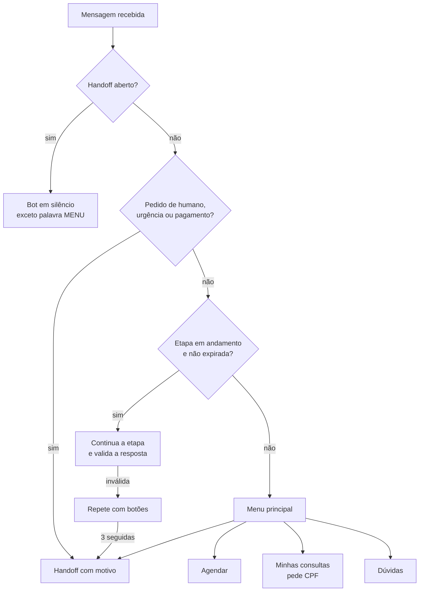

# Plano — POC de chatbot autossuficiente sobre a `clinica_simulada`

> Documento de planejamento, revisado em 2026-11-18 com as decisões da
> seção 2. **Fases 0 a 4 implementadas em 2026-11-18** (ver seção 11 e
> `plan-backlog.md`); migrations 010–014 aplicadas no Neon production.
> Objetivo final: apresentação da POC aos investidores do projeto.
>
> **Escopo:** é uma **POC**. O bot funciona sozinho em cima dos dados mock do
> schema `clinica_simulada` no Neon, lendo **e escrevendo** neles, para mostrar
> até onde o autoatendimento pode ir. Não há sistema de agenda externo nem
> dados de pacientes reais. Os números citados vêm da base sintética.

## 1. Objetivo

Um atendimento pelo WhatsApp em que o próprio bot resolve, de ponta a ponta:

- **agenda**: ver horários, marcar, remarcar, cancelar e confirmar presença,
  gravando direto na `clinica_simulada`;
- **identificação por CPF**, para mostrar as consultas do paciente;
- **triagem administrativa** do paciente novo;
- **FAQ completo** gerado a partir dos dados: serviços, preços particulares,
  convênios, horários, regras;
- **lembretes e encaixes**, de forma ativa.

**Princípio central:** a equipe só é chamada quando o paciente pede, ou quando
o caso realmente exige uma pessoa (seção 7).

## 2. Decisões tomadas

| # | Tema | Decisão |
|---|---|---|
| 1 | Sistema de agenda | Nenhum externo. O bot é autossuficiente e usa os dados mock |
| 2 | Confirmação da marcação | O bot **marca e confirma direto** na `clinica_simulada`, sem validação humana. Vale para avaliação e sessões |
| 3 | Antecedência mínima | Configurável na tabela de configuração: **24 h** para remarcar e cancelar |
| 4 | Convênios | Usar `d_convenios`, que já existe. **Todo convênio cobre todos os serviços igualmente** por enquanto |
| 5 | Valores particulares | **Podem aparecer.** O paciente confirma o CPF e, se bater, vê as próprias consultas, com opção de remarcar ou cancelar |
| 6 | Pagamentos e cobrança | Qualquer assunto de pagamento recebe uma **mensagem genérica e vai para a equipe** |
| 7 | Resumo do handoff | Fora de escopo por agora |
| 8 | Horário de atendimento humano | Na tabela de configuração: **08:00–18:00, todos os dias** |
| 9 | Retenção de mensagens | **Infinita** por enquanto: a POC serve para a apresentação aos investidores. A chave fica na configuração para o futuro |
| 10 | Autenticação do webhook | **Sem autenticação até o fim da POC**, inclusive para a escrita na agenda. Documentado em `CLAUDE.md` e `docs/IMPLEMENTATION_STATUS.md` |

## 3. Diagnóstico dos dados mock

Conferido no Neon (projeto `chatmanager-homolog`, branch `production`).

### 3.1 O que já serve

| Tabela | Conteúdo | Uso pelo bot |
|---|---|---|
| `d_servicos` | 5 serviços: Pilates, Fisioterapia ambulatorial, RPG, Massagem, Fisioterapia pélvica. Duração de 60 min e vagas por horário (Pilates 4, Fisio 6, demais 1) | Menu de serviços, FAQ, regra de capacidade |
| `d_profissionais` | 8 profissionais, cada um ligado a um serviço | Escolha opcional de profissional |
| `f_capacidade` | Vagas por data, hora (06h–19h, hora cheia), profissional e serviço | Fonte dos horários livres |
| `d_calendario` | Dia útil e feriado (13 feriados) | Não oferecer horário em feriado; responder "abre dia X?" |
| `d_convenios` | Convênios A a E | Lista de convênios aceitos (decisão 4) |
| `d_pacientes` | 2.424 pacientes, com origem, canal e campanha | Identificação (com o CPF da seção 3.2) |
| `jornada_contatos` | `wa_id` → lead/paciente/conversa | Lembrar o paciente depois da primeira identificação |
| `f_agendamentos` | 30.386 agendamentos, com status, canal, lembrete e `remarcacao_de` | Minhas consultas, marcar, remarcar, cancelar, presença |
| `f_contratos` | Pacotes e convênios: sessões previstas e realizadas, risco | Sessões restantes, mensagem de retorno |
| `f_leads`, `d_campanhas` | Funil por etapa, canal, fora do horário | Registro da triagem do paciente novo |
| `faq_entries`, `message_templates`, `dispatches` | Conteúdo, templates e envios (hoje com textos `[SIMULACAO]`) | FAQ e mensagens ativas |

Como a simulação representa os status:

- Status de `f_agendamentos`: `Agendado`, `Realizado`, `Falta`,
  `Cancelado com antecedência`, `Cancelado em cima da hora`.
- **Remarcação:** cria uma linha nova com `remarcacao_de` apontando para a
  original, e a original recebe status de cancelamento ou falta.
- Canais (`canal_marcacao`): `Chatbot`, `Recepção`, `Grade fixa`.

### 3.2 O que falta (pré-requisitos da POC)

| Lacuna | Situação | Ação |
|---|---|---|
| **Agenda acaba no passado** | `f_capacidade` e `d_calendario` vão só até **2026-11-04** | Script que estende a grade e o calendário, repetindo o padrão semanal existente, e roda diariamente para manter sempre 60 dias à frente |
| IDs sem gerador | `agendamento_id`, `paciente_id` e `lead_id` são `bigint` sem sequence | Criar sequences começando em `max(id) + 1` e definir como default |
| Sem CPF | `d_pacientes` não tem documento | Adicionar `cpf` (único) e preencher com **CPFs fictícios válidos**. Criar alguns pacientes de demonstração com CPFs conhecidos para os testes |
| Preços particulares | Só implícitos em `f_agendamentos.valor_sessao` | Tabela `d_precos` montada a partir dos dados (abaixo) |
| Configuração | Não existe | Tabela `bot_config` (seção 4) |
| Conteúdo do FAQ | `faq_entries` com placeholders | Gerar o conteúdo a partir das tabelas e criar textos mock para endereço, documentos e regras |
| Permissão de escrita | A conexão do bot nunca escreveu na `clinica_simulada` | Conceder `insert`/`update` só nas tabelas que o bot altera |

Preços particulares observados nos dados mock (por sessão):

| Serviço | Avulso | Pacote | Mensalidade |
|---|---|---|---|
| Pilates | — | — | R$ 33,10 a 53,12 por sessão |
| Fisioterapia ambulatorial | R$ 120 | R$ 100 | — |
| RPG | R$ 150 | R$ 130 | — |
| Massagem | R$ 140 | — | — |
| Fisioterapia pélvica | R$ 160 | R$ 140 | — |

### 3.3 Onde cada dado fica

- **`public`** continua com o que vem do WhatsApp de verdade: `contacts`,
  `conversations`, `messages`, `whatsapp_flow_events`, e as tabelas novas do
  bot (`bot_config`, `conversation_state`, `handoffs`).
- **`clinica_simulada`** é a "clínica" da POC. O bot lê e escreve agenda,
  pacientes e leads ali, e as views `bi_simulado` passam a mostrar as
  marcações feitas pelo bot junto com o histórico simulado.
- As tabelas `public.appointment_*` (migration 009) e o fluxo atual de pedido
  com confirmação pela clínica **saem de uso** na POC, mas não são apagadas.

## 4. Tabela de configuração

`public.bot_config`, no formato chave → valor (`key text primary key`,
`value jsonb`, `description text`, `updated_at`). O bot lê na inicialização,
com cache curto, e mudar um valor não exige deploy.

| Chave | Valor inicial | Uso |
|---|---|---|
| `timezone` | `"America/Bahia"` | Todas as datas exibidas e as regras de prazo |
| `reschedule_min_notice_hours` | `24` | Abaixo disso, remarcar vai para a equipe |
| `cancel_min_notice_hours` | `24` | Abaixo disso, cancelar vai para a equipe |
| `human_support_hours` | `{"start": "08:00", "end": "18:00", "days": [0,1,2,3,4,5,6]}` | Define "fora do horário" (todos os dias) |
| `message_retention_days` | `null` (infinita) | Reservada para um job de limpeza futuro (seção 9) |
| `booking_horizon_days` | `21` | Até quantos dias à frente o bot oferece horários |
| `conversation_step_timeout_minutes` | `30` | Validade de uma etapa em andamento |
| `handoff_silence_hours` | `12` | Silêncio do bot depois de chamar a equipe (hoje é constante no código) |
| `cpf_max_attempts` | `3` | Tentativas de CPF por conversa antes de bloquear |
| `max_misunderstood_replies` | `3` | Respostas não entendidas seguidas antes de chamar a equipe |
| `reminder_hours_before` | `[24, 4]` | Primeiro e segundo lembrete |

## 5. Como seria a experiência

### 5.1 Paciente se identifica e remarca

```
Paciente: oi
Bot: Olá! Sou o assistente da PhysioVilas. → menu
Paciente: (toca "Minhas consultas")
Bot: Para sua segurança, digite seu CPF (só números).
Paciente: 12345678909
Bot: Obrigado, Ana! Suas próximas consultas:
     • RPG — qui, 20/11 às 08:00 (Carla)
     • RPG — qui, 27/11 às 08:00 (Carla)
     → lista: escolha uma para remarcar ou cancelar
Paciente: (escolhe 20/11) → [Remarcar] [Cancelar] [Voltar]
Paciente: (Remarcar) → dias com vaga → horários livres
Bot: Pronto! Sua sessão de 20/11 foi remarcada para sex, 21/11 às 10:00.
```

Gravação: nova linha em `f_agendamentos` (`canal_marcacao = 'Chatbot'`,
`remarcacao_de` = linha antiga), a antiga passa para
`Cancelado com antecedência`, e um registro vai para `audit_log`.

Se a consulta for em **menos de 24 h**, o bot não remarca. Responde: "Para
mudanças com menos de 24 h, nossa equipe vai te ajudar", e chama a equipe.

Depois do CPF confirmado, `jornada_contatos` liga o `wa_id` ao paciente, e nas
próximas conversas o bot já o reconhece. Mesmo assim, para remarcar ou
cancelar ele pede o CPF de novo.

### 5.2 Paciente novo, às 22h

```
Bot: Qual serviço você procura? → lista de serviços
Bot: Vai usar convênio ou particular? → Convênio A–E / Particular
     (particular → mostra o valor avulso e o do pacote)
Bot: Como conheceu a clínica? → Instagram / Google / Indicação / Médico / Outro
Bot: Seu nome completo? → Seu CPF?
Bot: Dias com vaga → horários livres
Bot: Avaliação marcada para seg, 24/11 às 14:00. Traga documento com foto
     e, se for convênio, a carteirinha. Endereço: ...
```

Gravação: `d_pacientes` (novo), `f_leads` (etapa final "Agendou pelo
chatbot", `fora_horario_comercial = 'Sim'` por ser depois das 18h),
`f_agendamentos` e `jornada_contatos`. Se a pessoa parar no meio, o lead fica
gravado com a etapa em que parou, como "Abandonou na escolha do horário".

### 5.3 Pagamento

```
Paciente: quero pagar minha mensalidade / tenho uma cobrança
Bot: Assuntos de pagamento são tratados pela nossa equipe.
     Já avisei e alguém continua por aqui. (fora do horário: "a partir das 08:00")
```

## 6. Estrutura do fluxo

### 6.1 Máquina de estados



- **Estado** em `public.conversation_state`: `conversation_id`, `flow`
  (`booking`, `my_appointments`, `triage`, `faq`), `step`, `context jsonb`
  (serviço, convênio, data escolhida, `paciente_id` verificado),
  `cpf_attempts` e `expires_at`.
- O `paciente_id` verificado vale só **dentro da conversa**. Quando a etapa
  expira, ele some do estado e o CPF é pedido de novo.
- **Texto livre:** palavras-chave simples ("remarcar", "cancelar", "convênio",
  "preço", "valor", "endereço", "horário", nome de serviço ou convênio).
  Não reconheceu → menu. Sem IA generativa para responder conteúdo.

### 6.2 Menu principal

Uma lista só, com no máximo 10 linhas e títulos de até 24 caracteres:

1. Agendar consulta
2. Minhas consultas (remarcar e cancelar entram aqui)
3. Serviços e valores
4. Convênios aceitos
5. Horários e endereço
6. Primeira consulta (o que levar e como funciona)
7. Falar com a equipe

### 6.3 Agenda: leitura e escrita na `clinica_simulada`

**Horários livres** = `f_capacidade.vagas` − agendamentos ativos
(`Agendado`/`Realizado`) no mesmo dia, hora, profissional e serviço.
Excluem-se feriados de `d_calendario`, horários já passados e datas além de
`booking_horizon_days`.

| Ação | Escrita | Regras |
|---|---|---|
| Marcar | `insert f_agendamentos` com status `Agendado`, `canal_marcacao` `Chatbot`, `data_marcacao` hoje, `antecedencia_dias`, `dia_semana`, `turno`, `forma_pagamento`, `convenio_id`, `valor_sessao` e `primeira_consulta` | Transação com trava por slot e nova checagem de vaga antes do insert. Sem vaga → oferece outros horários |
| Remarcar | Nova linha com `remarcacao_de`; a original vai para `Cancelado com antecedência` | Só com 24 h ou mais (`reschedule_min_notice_hours`) |
| Cancelar | Status `Cancelado com antecedência` | Só com 24 h ou mais. Logo depois oferece remarcar |
| Confirmar presença | `lembrete_confirmado = 'Sim'` | Resposta ao botão do lembrete |
| Toda escrita | `audit_log` (`entity_type`, `action`, `actor_scope = 'chatbot'`) | Rastreabilidade da demonstração |

`agendamento_chatbot` também é preenchida (agendamento → `wa_id` → conversa),
seguindo o padrão já usado pela simulação.

### 6.4 Identificação por CPF

- O bot pede o CPF só para ver, remarcar ou cancelar consultas, e no cadastro
  do paciente novo.
- Validação: formato e dígitos verificadores **antes** de consultar o banco.
- Busca em `d_pacientes.cpf`. Se não encontrar: "Não encontrei esse CPF. Quer
  agendar como paciente novo?" A resposta é a mesma para CPF inválido e para
  CPF não cadastrado.
- Depois de `cpf_max_attempts` (3) tentativas erradas, o fluxo de consultas
  fica bloqueado na conversa e a pessoa é oferecida à equipe.
- O CPF nunca é repetido nas respostas nem gravado em `messages.body`: a
  mensagem do paciente é gravada mascarada (`***.***.***-09`).

### 6.5 FAQ gerado a partir dos dados

| Tópico | Fonte |
|---|---|
| Serviços (duração, vagas por horário, profissionais) | `d_servicos`, `d_profissionais` |
| Valores particulares | `d_precos` |
| Convênios aceitos (todos para todos os serviços) | `d_convenios` |
| Horários de atendimento | Horas com capacidade em `f_capacidade` + `d_calendario` |
| Feriados | `d_calendario` |
| Endereço, o que levar, regra de cancelamento (24 h) | `faq_entries` (textos mock) + `bot_config` |

Cada resposta termina com botões: [Agendar] [Voltar ao menu] [Falar com a equipe].

### 6.6 Mensagens ativas (fase posterior)

Via `dispatches` e `message_templates`, por template fora da janela de 24 h
do WhatsApp:

| Template | Gatilho | Botões |
|---|---|---|
| `lembrete_consulta` | 24 h e 4 h antes | Confirmo / Remarcar / Cancelar |
| `confirmacao_agendamento` | Marcação feita fora da janela | — |
| Oferta de encaixe | Vaga liberada por cancelamento | Quero / Não posso |
| `retorno_tratamento` | Contrato abandonado em `f_contratos` | Agendar / Agora não |

Na POC, os templates só podem ser enviados a números de teste aprovados na
Infobip.

## 7. Quando chamar a equipe

| Motivo | Gatilho |
|---|---|
| `patient_request` | Botão "Falar com a equipe" ou texto "atendente", "humano", "pessoa" |
| `payment` | Qualquer assunto de pagamento, mensalidade ou cobrança (decisão 6) |
| `clinical_or_urgency` | Pergunta clínica ou urgência. Na urgência, o bot orienta procurar o SAMU (192) antes de chamar a equipe |
| `late_change` | Remarcar ou cancelar com menos de 24 h |
| `bot_failure` | 3 respostas seguidas não entendidas |
| `identity_failure` | CPF errado 3 vezes |
| `document_request` | Atestado, declaração, nota fiscal |

Fora dessa lista o bot resolve sozinho.

Cada handoff é gravado em `public.handoffs`: motivo, `requested_at`,
`in_business_hours`, `first_team_reply_at`. Depois de chamar a equipe, o bot
fica em silêncio por `handoff_silence_hours`, e MENU sempre volta ao bot.
Fora de 08:00–18:00, a mensagem informa quando a equipe responde. O resumo
para a equipe está fora de escopo (decisão 7).

## 8. Métricas (Power BI)

As views `bi_simulado` passam a incluir as marcações do bot automaticamente,
porque leem as mesmas tabelas. Novas views em `reporting`:

- autoatendimento: conversas sem handoff;
- handoffs por motivo e por horário;
- funil do bot: menu → serviço → horário → marcado, com abandono por etapa;
- marcações, remarcações e cancelamentos feitos pelo bot (`canal_marcacao = 'Chatbot'` + `audit_log`).

Referência da simulação: 62% dos leads agendaram pelo bot e 14,6% foram para
a equipe. Faltas: ~6% com lembrete confirmado, ~35% sem confirmação.

## 9. Retenção

- **Infinita na POC** (decisão 9). Nenhuma mensagem é apagada, o que também
  preserva o histórico dos gráficos do Power BI para a apresentação.
- `message_retention_days` fica em `bot_config` com valor `null`. Se um dia
  receber um número, o job de limpeza terá de guardar os agregados diários
  antes de apagar, porque as views de `reporting` são calculadas a partir de
  `messages`.
- Só `conversation_state` é limpo quando expira, porque é estado temporário e
  não histórico.

## 10. Segurança na POC

- **Webhook sem autenticação até o fim da POC** (decisão 10).
  `allowUnauthenticatedInbound` continua ligado em `src/bootstrap.js`, e os
  fluxos de agenda do paciente (marcar, remarcar, cancelar) passam a rodar
  **sem exigir webhook autenticado**. Hoje o código só libera a agenda com a
  autenticação ativa, e essa trava será removida para os fluxos do bot.
- **Risco aceito:** quem descobrir a URL do webhook pode forjar mensagens e
  criar ou alterar agendamentos na `clinica_simulada`. Isso é aceitável porque
  os dados são mock. Antes de qualquer uso com pacientes reais, a autenticação
  (HMAC) volta a ser obrigatória e esta decisão precisa ser revista.
- Só CPFs fictícios na base. Nunca carregar CPF real na `clinica_simulada`.
- A conta de banco do bot escreve só em: `f_agendamentos`, `d_pacientes`
  (insert e `cpf`), `f_leads`, `jornada_contatos`, `agendamento_chatbot`,
  `audit_log` e as tabelas do bot no `public`.
- Nenhum dado de saúde é coletado na triagem.

## 11. Fases

| Fase | Entrega | Status (2026-11-18) |
|---|---|---|
| **0. Dados** | Migration ou script da POC: sequences, `d_pacientes.cpf` + CPFs fictícios + pacientes de demonstração, `d_precos`, `bot_config`, `conversation_state`, `handoffs`, permissões. Script de extensão da grade (`f_capacidade` + `d_calendario`) com execução diária. Textos mock em `faq_entries` | Feito: migrations 010–012 + `npm run extend-schedule` (grade até 17/01/2027) |
| **1. Motor e FAQ** | Máquina de estados, menu novo, FAQ lido do banco, handoff com motivos, horários do `bot_config`, eventos de fluxo para todas as etapas | Feito: `src/services/bot/engine.js`, fluxos `menu`/`faq`, migration 013 |
| **2. Agenda** | Marcar (contato já conhecido), CPF, minhas consultas, remarcar e cancelar com a regra de 24 h, `audit_log` | Feito: fluxos `booking` e `my_appointments`, `appointmentRepository.js` |
| **3. Paciente novo** | Triagem + cadastro + `f_leads` com etapa e abandono | Feito: fluxo `triage`, `patientRepository.js` |
| **4. Métricas** | Views em `reporting` e páginas do Power BI para a apresentação | Feito: views `reporting.bot_*` (migration 014); páginas do Power BI pendentes |
| **5. Mensagens ativas** | Lembretes com confirmação e encaixe (depende de templates aprovados) | Feito atrás de flag desligada (T19, `npm run schedule-reminders`); template e botões ainda não confirmados na Infobip |

Cada fase entra com testes (`npm run check`, `npm test`) e atualiza
`docs/IMPLEMENTATION_STATUS.md` e `CLAUDE.md`, porque a regra "sem lógica de
bot no código" fica ainda mais ampliada.
